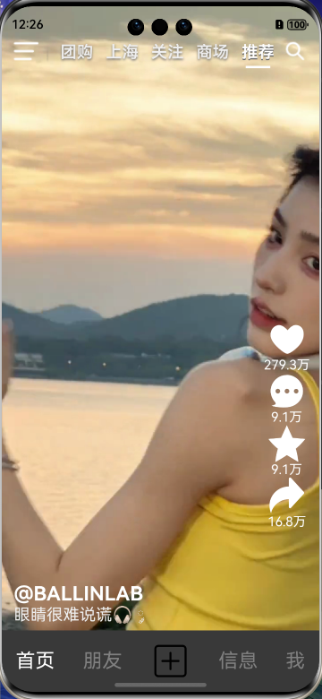

# TikTok

#### 介绍

# 鸿蒙基础版抖音

# V2.0.0

当前已实现功能有

1. 抖音推荐页视频 未实现相关算法

2. 视频的点赞 评论 倍速播放
3. 基于AI接口的聊天功能
4. 登录功能没有后台,只做了本地存储和删除
5. 侧边栏的展示 未实现对应的按钮的功能
6. 搜索页面 未实现功能
7. 商品页实现了预览 搜索 筛选
8. 视频评论支持长按弹出气泡删除

#### 更新内容

1. 状态管理整体迁移到 V2: `@ComponentV2` / `@ObservedV2` + `@Trace` / `@Local` / `@Param` / `@Event` / `@Provider` + `@Consumer` / `@Monitor`,复用节点改用 `@ReusableV2`
2. 全局状态由 AppStorage 键值改为 `AppStorageV2.connect` 的单例 `GlobalState`,非响应式基础设施(context / UIContext / 路由栈)集中在 `AppEnv`
3. 路由整体改用 Navigation: 单 `@Entry` 宿主 + `NavPathStack`,废弃 `router.*` 与多页面注册
4. 路由表改为系统动态路由: `module.json5` 的 `routerMap` 指向 `resources/base/profile/router_map.json`,每个路由页导出 `@Builder XxxBuilder()`,页面参数在 `NavDestination.onReady` 里读 `pathInfo.param`;全应用只有一个 `NavPathStack`(即 `AppEnv.pathStack`),跳转/返回统一由 `common.nav` / `common.back` / `common.navWithClear` 封装
5. 双向绑定统一使用 V2 语法糖 `!!`(自定义组件需同时声明 `@Param x` 与 `@Event $x`;系统组件用后缀 `this.x!!`)
6. 视频评论由 `bindSheet` 改为 `NavDestinationMode.DIALOG` 半屏弹层(`CommentDialog`): 无蒙罩、视频不暂停,弹层把视频顶起压缩(高度经 `GlobalState.commentDialogHeight` 回传给 `VideoComp`),下拉手势或右上角 × 关闭;弹层出入场与视频压缩共用 `Constants.COMMENT_DIALOG_ANIM_DURATION`(100ms),拖动时不做补间
7. 播放/暂停按钮改为独立的居中绝对定位浮层(`HitTestMode.None`),不随视频压缩移动、不拦截视频点击;视频画面区改为 `Column` + `layoutWeight` 真实分高,压缩时画面等比缩进
8. 评论删除交互由侧滑改为长按气泡(`bindPopup`)
9. 聊天页重做: 用实测安全区高度替代百分比边距,返回键改 `sys.symbol.chevron_left`,气泡按左右分列(自己=品牌色白字,对方=白底深字)且限宽 70%,间隔超 5 分钟插入时间分隔,发送按钮常驻并在空内容时禁用
10. 联系人默认数据改用英文名池,与网络头像成套按 id 稳定取样;空昵称统一按 id 兜底英文名
11. 修复评论发出去看不到、重开弹层后消失: `@ObservedV2` 实例不能直接 `JSON.stringify`(字段会带 `__ob_` 前缀),落库前统一用 `toPlain()` / `userToPlain()` 转普通对象,聊天记录、当前用户与登录 token 同步修复;读取时丢弃旧版本落库的空记录
12. 修复上下滑切换视频时画面大小抖动: 视频高度补偿量改由不随滑动移动的 `Swiper` 测量后下发给 `VideoComp`,不再由每个视频项按自身滚动位置实时计算;评论弹层拖动成为唯一改变画面高度的入口
13. 修复滑动视频时侧边栏图标偶尔消失: 进度调节手势限定为水平方向,垂直滑动交给 `Swiper`,并补充 `onActionCancel` 恢复侧边栏、视频描述与进度条状态

#### 预览效果

#### 软件架构

1. 使用单Hap包架构

#### 安装教程

1. 使用DevEco Studio 直接 克隆仓库

#### 使用说明

1. 非商用 模仿抖音的功能

#### 参与贡献

Author: Yancy
Email: 2362576803@qq.com

